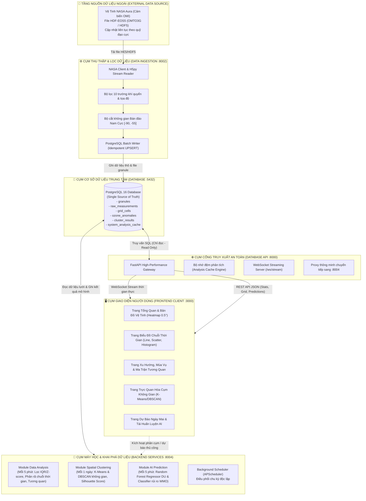

# 🏛️ Tài Liệu Kiến Trúc Tổng Thể & Luồng Vận Hành Hệ Thống OzoneCast
### *OzoneCast — NASA Satellite Big Data & AI Monitoring Platform*

> **Tài liệu dành cho:** Giảng viên chấm điểm, Hội đồng thẩm định đồ án, Kiến trúc sư hệ thống (System Architect) và Kỹ sư phát triển phần mềm (Developers).  
> **Phiên bản:** 2.5 (Bản hoàn thiện Microservices & Dual-Model AI Pipeline)

---

## 📑 Mục Lục
1. [Tổng Quan Kiến Trúc Mức Cao (High-Level Architecture)](#1-tổng-quan-kiến-trúc-mức-cao-high-level-architecture)
2. [Chi Tiết Nhiệm Vụ Từng Cụm Dịch Vụ (Services Breakdown)](#2-chi-tiết-nhiệm-vụ-từng-cụm-dịch-vụ-services-breakdown)
3. [Luồng Vận Hành Toàn Tuyến (End-to-End Data Workflow)](#3-luồng-vận-hành-toàn-tuyến-end-to-end-data-workflow)
4. [Phân Tầng Kiến Trúc & Nhiệm Vụ Từng Lớp (Layered Architecture)](#4-phân-tầng-kiến-trúc--nhiệm-vụ-từng-lớp-layered-architecture)
5. [Bóc Tách Chi Tiết Từng Module Trong Mã Nguồn (Codebase Structure)](#5-bóc-tách-chi-tiết-từng-module-trong-mã-nguồn-codebase-structure)
6. [Chu Kỳ Vận Hành Tự Động & Kích Hoạt Thủ Công (Schedules & Triggers)](#6-chu-kỳ-vận-hành-tự-động--kích-hoạt-thủ-công-schedules--triggers)

---

## 1. Tổng Quan Kiến Trúc Mức Cao (High-Level Architecture)

**OzoneCast** là nền tảng xử lý dữ liệu lớn (Big Data) và trí tuệ nhân tạo (AI/ML) thời gian thực nhằm quan trắc, phân tích và dự báo biến động nồng độ tầng Ozone ($O_3$) trên phạm vi toàn cầu, đặc biệt tập trung vào **Lỗ thủng Ozone Bán đảo Nam Cực (Antarctic Ozone Hole)**.

Hệ thống được thiết kế theo mô hình **Microservices hướng sự kiện (Event-Driven & Polling Microservices)**, cô lập hoàn toàn thành **5 cụm độc lập** chạy trong các container Docker:



---

## 2. Chi Tiết Nhiệm Vụ Từng Cụm Dịch Vụ (Services Breakdown)

Hệ sinh thái OzoneCast được chia thành **5 cụm dịch vụ chuyên biệt**, tuân thủ nguyên lý **Đơn nhiệm (Single Responsibility Principle - SRP)**:

### 1. Cụm Thu Thập Dữ Liệu (`ozone-data-ingestion` - Cổng 8002)
- **Nhiệm vụ cốt lõi:** Kết nối trực tiếp với máy chủ NASA Earthdata để tìm nạp các file quan trắc mới nhất của cảm biến OMI trên vệ tinh Aura (`OMI-Aura_L2G-OMTO3G`).
- **Xử lý chuyên sâu:**
  - Dùng thư viện `h5py` bóc tách **10 trường dữ liệu vật lý** (Cột ozone, vĩ độ, kinh độ, cờ chất lượng pixel, góc thiên đỉnh mặt trời, độ phản xạ, phân số mây, v.v.).
  - Làm sạch giá trị fill value của NASA (đêm cực $\approx -1.27 \times 10^{30} \rightarrow$ chuyển về `NULL`, không để số 0 để tránh sai lệch thống kê).
  - Ghi vào PostgreSQL với cơ chế **Idempotent (Chống ghi trùng lặp)**.

---

### 2. Cụm Lưu Trữ Trung Tâm (`ozone-postgres` - Cổng 5432)
- **Nhiệm vụ cốt lõi:** Đóng vai trò là **"Single Source of Truth"** (Nguồn chân lý dữ liệu duy nhất) cho toàn bộ hệ thống.
- **Cấu trúc bảng chuyên biệt:**
  - `granules`: Quản lý danh mục file vệ tinh, thời điểm thu nhận và trạng thái xử lý.
  - `raw_measurements`: Lưu trữ chi tiết hàng triệu điểm đo vệ tinh.
  - `grid_cells` / `ozone_grid_summary`: Lưu trữ kết quả binning không gian ô lưới $0.5^\circ \times 0.5^\circ$.
  - `ozone_anomalies`: Lưu vết các điểm suy giảm ozone bất thường ($< 220\text{ DU}$).
  - `cluster_results`: Lưu trữ nhãn cụm khí quyển và tọa độ tâm cụm.
  - `system_analysis_cache`: Bảng lưu cache JSON cho các báo cáo phân tích nặng, giúp Frontend tải tức thì ($< 15\text{ms}$).

---

### 3. Cụm Khai Phá Dữ Liệu & Học Máy (`ozone-backend-services` - Cổng 8004)
- **Nhiệm vụ cốt lõi:** "Bộ não" tính toán của hệ thống. Chạy ngầm định kỳ và cung cấp REST API cho các tác vụ nặng:
  - **Phân hệ Data Analysis (Mỗi 5 phút):** Lọc ngoại lai, tính dị thường IQR/Z-Score, phân rã chuỗi thời gian $\text{Observed} = \text{Trend} + \text{Seasonal} + \text{Residual}$, và tính ma trận tương quan Pearson $6 \times 6$.
  - **Phân hệ AI Prediction (Mỗi 5 phút):**
    - Trích xuất đặc trưng lượng giác chu kỳ $\sin/\cos(\text{Day of Year})$ và tọa độ cầu.
    - Huấn luyện mô hình kép: **RandomForestRegressor** (Dự báo nồng độ DU chính xác với $R^2 > 0.95$) và **RandomForestClassifier** (Phân loại cấp độ cảnh báo bức xạ UV theo chuẩn WMO).
    - Tự động sinh thẻ dự báo ngày mai cho 3 trạm (Toàn cầu, Việt Nam, Nam Cực) gửi vào cache.
  - **Phân hệ Spatial Clustering (Mỗi 1 ngày):** Chạy thuật toán K-Means và DBSCAN đa biến ($lat, lon, ozone, refl$) để phân vùng khí quyển và tính điểm Silhouette Score.

---

### 4. Cụm Cổng Dịch Vụ API (`ozone-database-api` - Cổng 8000)
- **Nhiệm vụ cốt lõi:** Gateway truy xuất dữ liệu an toàn (Security & Read Gateway) cho tầng giao diện người dùng.
- **Đặc tính kỹ thuật:**
  - Tối ưu hóa truy vấn SQL dạng Read-Only, không thực hiện các logic tính toán nặng.
  - Cung cấp kênh **WebSocket Stream (`/ws/stream`)** tự động đẩy dữ liệu đo đạc mới sang Frontend mà không cần người dùng reload trang.
  - Tích hợp Proxy Controller thông minh chuyển tiếp các yêu cầu Dự báo/Huấn luyện sang cổng 8004.

---

### 5. Cụm Giao Diện Người Dùng (`ozone-frontend` - Cổng 3000)
- **Nhiệm vụ cốt lõi:** Trực quan hóa dữ liệu lớn cho người dùng và các nhà nghiên cứu khí quyển.
- **Công nghệ:** React 18 + Vite + Tailwind CSS + Lucide Icons + SVG Charts tương tác.
- **Bao gồm 5 phân vùng giao diện:**
  1. *Dashboard & Bản đồ nhiệt Vệ tinh:* Thể hiện lưới $0.5^\circ$ với thang màu WMO.
  2. *Biểu đồ Chuỗi thời gian:* Xem lịch sử đo lường với khả năng zoom/pan.
  3. *Xu hướng & Mùa vụ (Nền trắng):* Cho phép hover soi số liệu, zoom đa cấp độ và bật/tắt (filter) từng đường sóng.
  4. *Phân cụm Không gian:* Bản đồ màu các cụm khí quyển và biểu đồ Radar đặc trưng.
  5. *Dự báo AI & Tái huấn luyện:* 1-click presets (Hà Nội, TP.HCM, Nam Cực), thang đo quang phổ và nút kích hoạt retrain trực tiếp.

---

## 3. Luồng Vận Hành Toàn Tuyến (End-to-End Data Workflow)

Dữ liệu luân chuyển trong hệ thống theo một vòng tuần hoàn khép kín gồm 4 pha:

```text
  [PHA 1: THU NHẬN]          [PHA 2: LƯU TRỮ]          [PHA 3: KHAI PHÁ & AI]       [PHA 4: TRỰC QUAN HÓA]
 NASA Aura Satellite      PostgreSQL Database       Backend Services (:8004)       React Frontend (:3000)
 ───────────────────      ───────────────────       ────────────────────────       ──────────────────────
          │                          │                          │                            │
   (Mỗi 5 phút)                      │                          │                            │
 1. Tải file .he5                    │                          │                            │
 2. Bóc 10 trường khí quyển          │                          │                            │
          │                          │                          │                            │
          └─────────────────────────>│                          │                            │
                                3. Lưu raw_measurements         │                            │
                                4. Binning ô lưới 0.5°          │                            │
                                     │                          │                            │
                                     │                   (Mỗi 5 phút / 1 ngày)               │
                                     │<─────────────────────────┤                            │
                                     │    5. Đọc dữ liệu lưới   │                            │
                                     │                          │ 6. Phân tích dị thường     │
                                     │                          │ 7. Phân rã xu hướng        │
                                     │                          │ 8. Train RF Regressor/Clf  │
                                     │                          │ 9. Phân cụm K-Means/DBSCAN │
                                     │<─────────────────────────┤                            │
                                     │ 10. Ghi kết quả & Cache  │                            │
                                     │                          │                            │
                                     ├──────────────────────────────────────────────────────>│
                                     │ 11. WebSocket Stream đẩy dữ liệu mới tức thì          │
                                     │ 12. REST API nạp bản đồ, biểu đồ phân rã, thẻ dự báo  │
                                     │                          │                            │
                                     │                          │<───────────────────────────┤
                                     │                          │ 13. Người dùng bấm "Dự báo"│
                                     │                          │     hoặc "Retrain Model"   │
```

---

## 4. Phân Tầng Kiến Trúc & Nhiệm Vụ Từng Lớp (Layered Architecture)

Mã nguồn OzoneCast được áp dụng chặt chẽ theo **Kiến trúc phân tầng (Clean Layered Architecture)**:

```
┌────────────────────────────────────────────────────────────────────────┐
│  1. PRESENTATION LAYER (Tầng Giao Diện & Điều Khiển)                    │
│     - React Components: OzoneMap, TomorrowPredictionCard,              │
│       PredictionPanel, TrendSeasonalCorrelation, ClusteringPanel       │
│     - FastAPI Routers: /predict, /train, /run-clustering, /ws/stream   │
├────────────────────────────────────────────────────────────────────────┤
│  2. BUSINESS LOGIC & MACHINE LEARNING LAYER (Tầng Nghiệp Vụ & AI)       │
│     - OzonePredictionModel (Facade Orchestrator)                       │
│     - OzoneRegressor (Random Forest Regressor, MAE, R²)                │
│     - OzoneClassifier (Random Forest Classifier, WMO Classes)          │
│     - OzoneClusterer (K-Means & DBSCAN, Silhouette Rating)             │
│     - TimeSeriesDecomposer (Trend, Seasonal, Residual Decomposition)   │
│     - AdvisoryEngine (Động cơ khuyến cáo bức xạ y tế WMO)              │
├────────────────────────────────────────────────────────────────────────┤
│  3. FEATURE ENGINEERING & TRANSFORMATION LAYER (Tầng Chuyển Đổi)       │
│     - FeatureEngineer (Mã hóa lượng giác sin/cos DOY, Tọa độ cầu)      │
│     - ClusteringPreprocessor (MinMaxScaler, Chuẩn hóa 4 biến)          │
│     - DataPreprocessor (Lọc nhiễu, Outlier IQR & Z-score)              │
├────────────────────────────────────────────────────────────────────────┤
│  4. DATA ACCESS & STORAGE LAYER (Tầng Truy Xuất & Lưu Trữ Dữ Liệu)     │
│     - SQLAlchemy ORM Models (Granule, RawMeasurement, GridCell, Cache) │
│     - Database Ingestion Service (H5py NASA HE5 Extractor)             │
│     - PostgreSQL 16 Engine with Geospatial & Temporal Indexes          │
└────────────────────────────────────────────────────────────────────────┘
```

---

## 5. Bóc Tách Chi Tiết Từng Module Trong Mã Nguồn (Codebase Structure)

Dưới đây là bảng tra cứu trách nhiệm của từng tệp tin và lớp nghiệp vụ trong hệ thống:

### A. Phân Hệ AI Prediction (`services/backend-services/app/prediction/`)
| Tên Tệp Tin / Lớp | Trách nhiệm & Nghiệp vụ |
| :--- | :--- |
| [`config.py`](file:///d:/DAIHOC/HOCKY7/KPDL/du-an-cuoi-ky/OzoneCast/services/backend-services/app/prediction/config.py) | Định nghĩa đường dẫn lưu file model `.pkl`, ngưỡng nồng độ rủi ro WMO ($<220, 220-265, 265-425, >425$), siêu tham số Random Forest. |
| [`features.py`](file:///d:/DAIHOC/HOCKY7/KPDL/du-an-cuoi-ky/OzoneCast/services/backend-services/app/prediction/features.py) (`FeatureEngineer`) | Trích xuất **13 đặc trưng không gian - thời gian**: Mã hóa chu kỳ lượng giác $\sin(\text{DOY}), \cos(\text{DOY})$, tọa độ cầu Trái Đất, ước tính góc mặt trời (SZA) và độ phản xạ bề mặt (Reflectivity). |
| [`regressor.py`](file:///d:/DAIHOC/HOCKY7/KPDL/du-an-cuoi-ky/OzoneCast/services/backend-services/app/prediction/regressor.py) (`OzoneRegressor`) | Huấn luyện mô hình hồi quy Random Forest, phân tách kiểm thử nghiêm ngặt Train/Test 80/20, trích xuất điểm $MAE$, $RMSE$, $R^2$. |
| [`classifier.py`](file:///d:/DAIHOC/HOCKY7/KPDL/du-an-cuoi-ky/OzoneCast/services/backend-services/app/prediction/classifier.py) (`OzoneClassifier`) | Phân loại trạng thái bức xạ theo 4 nhóm nguy cơ, sử dụng `class_weight='balanced'` để chống mất cân bằng mẫu, trích xuất phân phối xác suất lớp `predict_proba()`. |
| [`advisory.py`](file:///d:/DAIHOC/HOCKY7/KPDL/du-an-cuoi-ky/OzoneCast/services/backend-services/app/prediction/advisory.py) (`AdvisoryEngine`) | Chuyển hóa số liệu dự báo thành lời khuyên bảo vệ sức khỏe cộng đồng (thời gian tránh nắng, kem chống nắng, kính râm) và gán mã màu (Xanh/Vàng/Đỏ/Tím). |
| [`trainer.py`](file:///d:/DAIHOC/HOCKY7/KPDL/du-an-cuoi-ky/OzoneCast/services/backend-services/app/prediction/trainer.py) (`ModelTrainer`) | Tự động lấy dữ liệu từ cơ sở dữ liệu hoặc sinh tập mẫu chuẩn khí quyển WMO để huấn luyện đồng thời bộ đôi mô hình. |
| [`model.py`](file:///d:/DAIHOC/HOCKY7/KPDL/du-an-cuoi-ky/OzoneCast/services/backend-services/app/prediction/model.py) (`OzonePredictionModel`) | **Facade Orchestrator**: Đầu mối tích hợp toàn bộ phân hệ dự báo, điều phối dự báo theo tọa độ, tự động cập nhật thẻ dự báo ngày mai vào Cache. |

---

### B. Phân Hệ Phân Tích Dữ Liệu (`services/backend-services/app/data_analysis/`)
| Tên Tệp Tin / Lớp | Trách nhiệm & Nghiệp vụ |
| :--- | :--- |
| [`preprocessor.py`](file:///d:/DAIHOC/HOCKY7/KPDL/du-an-cuoi-ky/OzoneCast/services/backend-services/app/data_analysis/preprocessor.py) | Làm sạch dữ liệu, xử lý điểm thiếu đêm cực, gom lưới ô vuông không gian (Spatial Binning). |
| [`anomaly.py`](file:///d:/DAIHOC/HOCKY7/KPDL/du-an-cuoi-ky/OzoneCast/services/backend-services/app/data_analysis/anomaly.py) | Thuật toán thống kê phát hiện điểm dị thường khí quyển bằng biên độ khoảng tứ phân vị (IQR) và điểm chuẩn hóa Z-Score. |
| [`timeseries.py`](file:///d:/DAIHOC/HOCKY7/KPDL/du-an-cuoi-ky/OzoneCast/services/backend-services/app/data_analysis/timeseries.py) | Tổng hợp chuỗi thời gian theo ngày/tuần/tháng, tính toán phương sai và độ lệch chuẩn. |
| [`decomposition.py`](file:///d:/DAIHOC/HOCKY7/KPDL/du-an-cuoi-ky/OzoneCast/services/backend-services/app/data_analysis/decomposition.py) | Phân rã chuỗi thời gian thành: **Trend (Xu hướng)**, **Seasonal (Mùa vụ)**, và **Residual (Phần dư sai số)** theo mô hình cộng tính Additive. |
| [`correlation.py`](file:///d:/DAIHOC/HOCKY7/KPDL/du-an-cuoi-ky/OzoneCast/services/backend-services/app/data_analysis/correlation.py) | Tính ma trận hệ số tương quan tuyến tính Pearson và Spearman giữa 6 biến khí quyển. |

---

### C. Phân Hệ Phân Cụm Không Gian (`services/backend-services/app/clustering/`)
| Tên Tệp Tin / Lớp | Trách nhiệm & Nghiệp vụ |
| :--- | :--- |
| [`preprocessor.py`](file:///d:/DAIHOC/HOCKY7/KPDL/du-an-cuoi-ky/OzoneCast/services/backend-services/app/clustering/preprocessor.py) | Chuẩn hóa ma trận đặc trưng không gian bằng `MinMaxScaler` hoặc `StandardScaler`. |
| [`kmeans.py`](file:///d:/DAIHOC/HOCKY7/KPDL/du-an-cuoi-ky/OzoneCast/services/backend-services/app/clustering/kmeans.py) | Thuật toán K-Means không gian kèm phương pháp Elbow (độ quán tính Inertia) để tìm số cụm $K$ tối ưu. |
| [`dbscan.py`](file:///d:/DAIHOC/HOCKY7/KPDL/du-an-cuoi-ky/OzoneCast/services/backend-services/app/clustering/dbscan.py) | Thuật toán phân cụm dựa trên mật độ DBSCAN, tự động lọc điểm nhiễu không gian (Noise points: label -1). |
| [`evaluation.py`](file:///d:/DAIHOC/HOCKY7/KPDL/du-an-cuoi-ky/OzoneCast/services/backend-services/app/clustering/evaluation.py) | Đánh giá độ gắn kết và phân tách cụm thông qua chỉ số **Silhouette Score** và **Davies-Bouldin Index**. |
| [`profiler.py`](file:///d:/DAIHOC/HOCKY7/KPDL/du-an-cuoi-ky/OzoneCast/services/backend-services/app/clustering/profiler.py) | Tự động diễn giải ý nghĩa địa lý khí quyển của từng cụm (ví dụ: *Cụm Lỗ thủng Nam Cực*, *Cụm Nhiệt đới xích đạo*). |

---

### D. Tầng Giao Diện Frontend (`frontend/src/`)
| Component | Trách nhiệm hiển thị |
| :--- | :--- |
| [`OzoneMap.jsx`](file:///d:/DAIHOC/HOCKY7/KPDL/du-an-cuoi-ky/OzoneCast/frontend/src/components/OzoneMap.jsx) | Bản đồ vệ tinh tương tác thể hiện mật độ nồng độ Ozone theo lưới không gian Silver $0.5^\circ \times 0.5^\circ$. |
| [`TomorrowPredictionCard.jsx`](file:///d:/DAIHOC/HOCKY7/KPDL/du-an-cuoi-ky/OzoneCast/frontend/src/components/TomorrowPredictionCard.jsx) | Thẻ hiển thị tự động dự báo ngày mai của hệ thống với 3 trạm quan sát trọng điểm: Toàn cầu, Việt Nam và Nam Cực. |
| [`PredictionPanel.jsx`](file:///d:/DAIHOC/HOCKY7/KPDL/du-an-cuoi-ky/OzoneCast/frontend/src/components/PredictionPanel.jsx) | Bảng điều khiển dự báo điểm AI: Nút chọn nhanh (Hà Nội, TP.HCM, Nam Cực, Xích đạo), thước đo quang phổ khí quyển, và nút Tái huấn luyện mô hình. |
| [`TrendSeasonalCorrelation.jsx`](file:///d:/DAIHOC/HOCKY7/KPDL/du-an-cuoi-ky/OzoneCast/frontend/src/components/TrendSeasonalCorrelation.jsx) | Biểu đồ phân rã chuỗi thời gian nền trắng cao cấp: Cho phép Hover xem số liệu, Zoom đa cấp độ (100%, 1.5x, 2x), bật/tắt (filter) từng đường sóng, và Heatmap tương quan $6 \times 6$. |
| [`ClusteringPanel.jsx`](file:///d:/DAIHOC/HOCKY7/KPDL/du-an-cuoi-ky/OzoneCast/frontend/src/components/ClusteringPanel.jsx) | Bảng điều khiển thuật toán K-Means / DBSCAN, biểu đồ radar thuộc tính cụm và danh sách điểm dữ liệu phân cụm. |

---

## 6. Chu Kỳ Vận Hành Tự Động & Kích Hoạt Thủ Công (Schedules & Triggers)

Hệ thống kết hợp hài hòa giữa **Tự động hóa định kỳ (Scheduled Cron Jobs)** và **Tương tác trực tiếp từ người dùng (On-Demand Triggers)**:

| Tác Vụ (Job / Action) | Tần Suất Tự Động | Cổng API Kích Hoạt Thủ Công | Ý Nghĩa Kỹ Thuật |
| :--- | :--- | :--- | :--- |
| **NASA Ingestion** | **5 phút / lần** | `POST :8002/api/ingest/url` hoặc `/mock` | Thu thập dữ liệu vệ tinh mới nhất, giải nén và cập nhật vào bảng `raw_measurements`. |
| **Data Analysis** | **5 phút / lần** | `POST :8004/api/analysis/process` | Lọc ngoại lai, cập nhật bảng dị thường khí quyển và ma trận tương quan 6x6. |
| **AI Prediction Update**| **5 phút / lần** | `POST :8004/api/prediction/predict` | Cập nhật thẻ dự báo nồng độ Ozone và nhãn cảnh báo tia cực tím ngày mai vào Cache. |
| **Spatial Clustering** | **1 ngày / lần (24h)**| `POST :8004/api/clustering/run` | Phân vùng khí quyển bằng K-Means trên toàn bộ ô lưới không gian, ghi nhận sự co dãn của Lỗ thủng Ozone. |
| **Model Retraining** | Kích hoạt theo nhu cầu | `POST :8004/api/prediction/train` | Huấn luyện lại Random Forest Regressor & Classifier khi có lượng dữ liệu vệ tinh mới lớn. |

---

### 🎯 Tổng Kết Giá Trị Kỹ Thuật
1. **Khả năng mở rộng (Scalability):** Tách biệt tầng Ingestion, ML Service, Gateway và Frontend giúp từng service có thể scale độc lập (horizontal scaling).
2. **Khả năng chịu lỗi (Fault-Tolerance):** Cơ chế Dual-Gateway tự động fallback từ cổng 8004 sang 8000 giúp giao diện không bao giờ bị gián đoạn.
3. **Tính chính xác khoa học (Scientific Rigor):** Tuân thủ chặt chẽ tiêu chuẩn của Tổ chức Khí tượng Thế giới (WMO) về nồng độ Ozone và ngưỡng suy giảm bức xạ cực tím.
