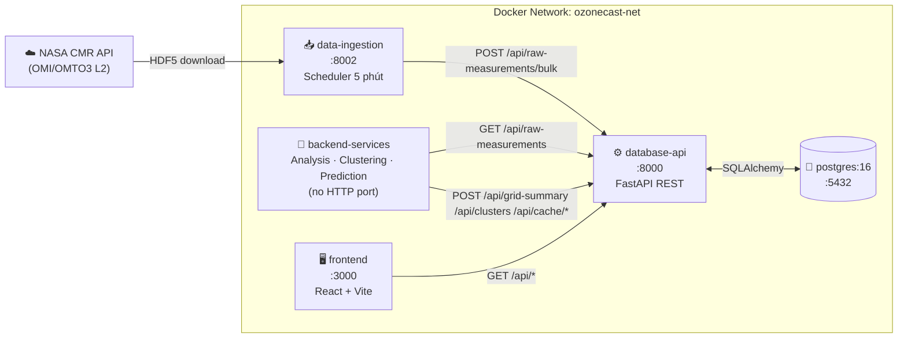

# 🌍 OzoneCast — NASA Ozone Monitoring System

Hệ thống theo dõi tầng ozone toàn cầu theo thời gian thực, sử dụng dữ liệu vệ tinh NASA OMI/Aura.

## Kiến trúc Microservice



### Vai trò từng service

| Service | Port | Mô tả |
|---------|------|--------|
| `postgres` | 5432 | PostgreSQL 16 — lưu trữ toàn bộ dữ liệu |
| `database-api` | **8000** | FastAPI + SQLAlchemy — gateway duy nhất vào DB |
| `data-ingestion` | 8002 | Tải dữ liệu NASA CMR mỗi 5 phút, fallback sang mock |
| `backend-services` | — | Analysis (5 phút) + Clustering (1 ngày) + Prediction (5 phút) |
| `frontend` | 3000 | React + Vite + Tailwind — dashboard biểu đồ |

---

## Cấu trúc thư mục

```
OzoneCast/
├── docker-compose.yml
├── .env.example                        ← biến dùng chung (POSTGRES_*, NASA_*, interval)
├── .gitignore
├── db/
│   └── init/
│       └── 01_init.sql                 ← khởi tạo tất cả bảng + index
├── services/
│   ├── data-ingestion/                 ← Service 1
│   │   ├── app/
│   │   │   ├── main.py                 ← FastAPI + APScheduler
│   │   │   ├── ingestion_service.py    ← xử lý HDF5 → push database-api
│   │   │   ├── nasa_client.py          ← tải file từ NASA Earthdata
│   │   │   └── mock_granule.py         ← tạo granule giả lập (HDF5)
│   │   ├── Dockerfile
│   │   ├── requirements.txt
│   │   └── .env.example
│   ├── database-api/                   ← Service 2
│   │   ├── app/
│   │   │   ├── main.py                 ← FastAPI endpoints + CORS
│   │   │   ├── database.py             ← SQLAlchemy engine
│   │   │   ├── models.py               ← ORM models (6 bảng)
│   │   │   └── schemas.py              ← Pydantic schemas
│   │   ├── Dockerfile
│   │   ├── requirements.txt
│   │   └── .env.example
│   └── backend-services/               ← Service 3 (gộp 3 phần)
│       ├── app/
│       │   ├── main.py                 ← APScheduler 3 jobs
│       │   ├── data_analysis/
│       │   │   └── analyzer.py         ← Timeseries / Trend / Correlation
│       │   ├── clustering/
│       │   │   └── clusterer.py        ← K-Means spatial clustering
│       │   └── prediction/
│       │       └── model.py            ← RandomForest Regression + Classification
│       ├── Dockerfile
│       ├── requirements.txt
│       └── .env.example
├── frontend/
│   ├── Dockerfile
│   ├── src/
│   └── ...
└── config/
    └── settings.py
```

---

## Khởi chạy hệ thống

### 1. Cấu hình môi trường

```bash
cp .env.example .env
```

Mở `.env` và điền thông tin:

```env
NASA_USERNAME=your_nasa_earthdata_username   # https://urs.earthdata.nasa.gov/
NASA_PASSWORD=your_nasa_earthdata_password
POSTGRES_USER=postgres
POSTGRES_PASSWORD=postgres
POSTGRES_DB=ozone_db
```

### 2. Build và chạy toàn bộ hệ thống

```bash
docker compose up --build
```

Hệ thống khởi động theo thứ tự:
1. `postgres` khởi động và khởi tạo bảng từ `db/init/01_init.sql`
2. `database-api` kết nối PostgreSQL, verify tables
3. `data-ingestion` bắt đầu tải dữ liệu NASA (hoặc mock nếu NASA không khả dụng)
4. `backend-services` chạy warmup ngay lập tức, sau đó theo lịch
5. `frontend` phục vụ dashboard tại `http://localhost:3000`

### 3. Chạy nền (production)

```bash
docker compose up --build -d
docker compose logs -f          # theo dõi logs tất cả services
docker compose logs -f backend-services   # chỉ xem 1 service
```

---

## URL kiểm tra

| URL | Mô tả |
|-----|-------|
| `http://localhost:3000` | Frontend dashboard |
| `http://localhost:8000/docs` | Swagger UI — tất cả API endpoints |
| `http://localhost:8000/health` | Health check database-api |
| `http://localhost:8000/api/data` | Dữ liệu gốc (raw measurements) |
| `http://localhost:8000/api/analysis` | Kết quả phân tích |
| `http://localhost:8000/api/clusters` | Kết quả clustering |
| `http://localhost:8000/api/predictions` | Dự báo ozone |
| `http://localhost:8002/health` | Health check data-ingestion |
| `http://localhost:8002/docs` | Swagger data-ingestion (trigger thủ công) |

### Trigger thủ công (dev/test)

```bash
# Trigger ingestion ngay lập tức (mock data)
curl -X POST http://localhost:8002/api/ingest/mock

# Trigger ingestion từ NASA CMR (cần credentials)
curl -X POST http://localhost:8002/api/ingest/real

# Xem stats hệ thống
curl http://localhost:8000/api/stats
```

---

## Chạy riêng từng service (local dev)

### database-api

```bash
cd services/database-api
cp .env.example .env
# Chỉnh DATABASE_URL trỏ về localhost nếu postgres đang chạy local
pip install -r requirements.txt
uvicorn app.main:app --reload --port 8000
```

### data-ingestion

```bash
cd services/data-ingestion
cp .env.example .env
pip install -r requirements.txt
uvicorn app.main:app --reload --port 8002
```

### backend-services

```bash
cd services/backend-services
cp .env.example .env
pip install -r requirements.txt
python -m app.main
```

### frontend

```bash
cd frontend
npm install
npm run dev        # http://localhost:5173
```

---

## Dừng hệ thống

```bash
docker compose down           # dừng, giữ dữ liệu
docker compose down -v        # dừng và XÓA toàn bộ dữ liệu (pgdata)
```

---

## Endpoints Database API (`/docs` để xem đầy đủ)

| Method | Path | Mô tả |
|--------|------|-------|
| GET | `/health` | Health check |
| GET | `/api/stats` | Thống kê tổng quan hệ thống |
| GET | `/api/data` | Raw measurements (query: `start`, `end`, `limit`) |
| GET | `/api/analysis` | Kết quả phân tích (timeseries, trend, correlation) |
| GET | `/api/clusters` | Kết quả K-Means clustering |
| GET | `/api/predictions` | Dự báo ozone ngày mai |
| GET | `/api/granules` | Danh sách granule đã nạp |
| GET | `/api/grid-summary` | Grid summary 0.5°×0.5° |
| GET | `/api/anomalies` | Vùng ozone bất thường |
| GET | `/docs` | Swagger UI tự động |

---

## Những thay đổi so với code gốc

### `data-ingestion/app/main.py`
- Dòng 49: `minutes=5` → `seconds=INGESTION_INTERVAL_SECONDS` (đọc từ env)
- Thêm `import os as _os` và `_INTERVAL_SECONDS = int(os.getenv(...))`
- Cập nhật log startup để hiển thị interval thực tế

### `database-api/app/main.py`
- Thêm `import os`
- CORS origins đọc từ `CORS_ORIGINS` env (default `*`)

### `database-api/Dockerfile`
- Port `8001` → `8000` (theo yêu cầu kiến trúc mới)
- Thêm `HEALTHCHECK`

### `data-ingestion/Dockerfile`
- Thêm `libhdf5-dev` vào apt packages
- Thêm `HEALTHCHECK`

### Logic nghiệp vụ
- **Không thay đổi**: `ingestion_service.py`, `nasa_client.py`, `mock_granule.py`, `analyzer.py`, `clusterer.py`, `model.py`

## Giả định

1. `DATABASE_API_URL` trong các service phân tích trỏ về `http://database-api:8000` (port mới)
2. `backend-services` không expose HTTP port — chỉ chạy scheduler nội bộ
3. Frontend `Dockerfile` đã tồn tại và được include trong docker-compose
4. `db/init/01_init.sql` được PostgreSQL tự động chạy khi volume `pgdata` trống (lần đầu khởi động)
5. Schema SQL được suy ra từ `services/database-api/app/models.py` — khớp 100% với SQLAlchemy ORM
