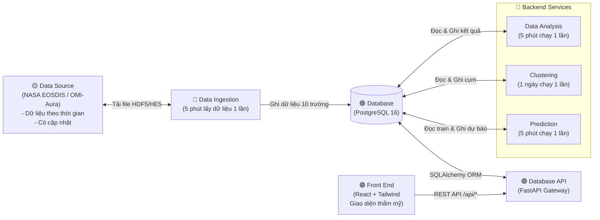

# 🌍 OzoneCast — Hệ Thống Giám Sát & Dự Đoán Tầng Ozone Vệ Tinh NASA

Hệ thống kiến trúc Microservice thu thập dữ liệu vệ tinh NASA (OMI/Aura), lưu trữ cơ sở dữ liệu thời gian thực, tự động phân tích chuỗi thời gian, phân cụm không gian và dự đoán suy giảm tầng ozone tại khu vực toàn cầu và Bán đảo Nam Cực.

---

## 🏗️ 1. Sơ Đồ Khối Kiến Trúc Hệ Thống

Kiến trúc hệ thống được thiết kế theo mô hình Microservice phân tán, mỗi khối chạy độc lập trong một container hoặc terminal riêng biệt:



### Luồng gọi và tương tác giữa các service:
1. **Data Source ➔ Data Ingestion (5 phút / lần):**
   - Lấy file dữ liệu vệ tinh từ URL NASA Earthdata (định dạng HDF5/HE5 như `OMI-Aura_L2G-OMTO3G...he5`).
   - Dùng thư viện `h5py` đọc và trích xuất **10 trường dữ liệu khí quyển & bề mặt**.
2. **Data Ingestion ➔ Database:**
   - Kết nối trực tiếp PostgreSQL và ghi các điểm đo vào bảng `raw_measurements` (kèm thông tin file vào `granules`).
3. **Backend Services ⮂ Database:**
   - **Data Analysis (mỗi 5 phút):** Đọc dữ liệu từ DB ➔ làm sạch, binning lưới tọa độ 0.5°×0.5°, tính chuỗi thời gian (Ngày/Tuần/Tháng), tách Trend/Seasonal, tính ma trận tương quan 6x6 ➔ ghi kết quả vào DB.
   - **Prediction (mỗi 5 phút):** Đọc dữ liệu DB ➔ huấn luyện mô hình RandomForest (Hồi quy DU + Phân loại cảnh báo nguy cơ suy giảm ozone) ➔ ghi dự báo ngày mai vào DB.
   - **Clustering (mỗi 1 ngày):** Đọc dữ liệu ➔ chạy phân cụm K-Means không gian (Latitude, Longitude, Ozone, Reflectivity) ➔ ghi thông tin đặc trưng từng cụm vào DB.
4. **Database ➔ Database API ➔ Front End:**
   - **Database API:** Đóng vai trò là cổng truy xuất duy nhất (Read Gateway) phục vụ client, không chứa logic nặng.
   - **Front End:** Gọi API lấy dữ liệu và hiển thị trực quan bản đồ nhiệt (Ozone Map), thẻ cảnh báo ngày mai, biểu đồ tương quan và phân cụm.

---

## 📊 2. Chi Tiết Các Trường Dữ Liệu Được Trích Xuất

Hệ thống sử dụng thư viện `h5py` trích xuất từ file HDF5/HE5 chuẩn NASA gồm 2 nhóm trường:

### 🔹 Nhóm 1: Bắt buộc (6 trường)
| Trường trong H5 | Cột CSDL | Kiểu dữ liệu | Mục đích sử dụng |
|---|---|---|---|
| **ColumnAmountO3** | `ozone_column_raw` | Float (DU) | **Biến chính** cần phân tích và dự đoán (Dobson Units). |
| **Latitude** | `latitude` | Float (deg) | **Cắt vùng Bán đảo Nam Cực** (`[-90°, -55°]`), vẽ bản đồ không gian. |
| **Longitude** | `longitude` | Float (deg) | Tọa độ kinh độ địa lý (`[-180°, 180°]`). |
| **SecondsInDay** / **Time** | `seconds_in_day` / `time_raw` | Float (giây) | **Xác định thời điểm đo**: Số giây từ 00:00 UTC của ngày (dễ dùng vì chỉ cần cộng với ngày trong tên file). |
| **QualityFlags** | `quality_flag` | Integer | **Lọc bỏ các điểm đo xấu** do lỗi thuật toán OMI. |
| **GroundPixelQualityFlags** | `ground_pixel_quality_flag` | Integer | **Lọc thêm theo chất lượng pixel mặt đất** (mây che khuất, băng tuyết bề mặt). |

### 🔹 Nhóm 2: Nên lấy thêm (4 trường)
| Trường trong H5 | Cột CSDL | Kiểu dữ liệu | Lý do & Mục đích sử dụng |
|---|---|---|---|
| **SolarZenithAngle** | `solar_zenith_angle` | Float (deg) | Ở vùng cực, Mặt Trời thấp sát chân trời nên dữ liệu kém tin cậy. Dùng trường này để **loại các điểm có góc quá lớn** (thường bỏ khi vượt khoảng 84° đến 88°). |
| **RadiativeCloudFraction** | `radiative_cloud_fraction` | Float (0.0–1.0) | Mây ảnh hưởng lớn đến độ chính xác ozone, dùng làm **feature quan trọng cho mô hình AI**. |
| **CloudPressure** | `cloud_pressure` | Float (hPa) | **Bổ sung thông tin áp suất đỉnh mây**. |
| **WaterFraction** / **LandWater** | `water_fraction` | Float (0.0–1.0) | **Phân biệt ô đất liền hay biển**, rất hữu ích cho vùng Bán đảo Nam Cực vì có cả băng, đất và nước. |

---

## 📁 3. Cấu Trúc Thư Mục Dự Án

```
OzoneCast/
├── docker-compose.yml              # Điều phối chạy toàn bộ hệ thống
├── .env.example                    # Mẫu biến môi trường chung
├── db/
│   └── init/
│       └── 01_init.sql             # SQL khởi tạo bảng, index và câu lệnh query mẫu
├── services/
│   ├── data-ingestion/             # Service 1: Tải file HDF5 & ghi DB
│   │   ├── app/
│   │   │   ├── main.py             # Entrypoint & Scheduler 5 phút
│   │   │   ├── ingestion_service.py# Đọc H5py 10 trường & ingest URL
│   │   │   ├── db.py               # Kết nối PostgreSQL có retry
│   │   │   ├── nasa_client.py      # Tải file qua curl
│   │   │   └── mock_granule.py     # Giả lập file .he5 đủ 10 trường
│   │   ├── Dockerfile
│   │   ├── requirements.txt
│   │   ├── README.md               # Hướng dẫn chi tiết chạy riêng data-ingestion
│   │   └── .env.example
│   ├── database-api/               # Service 2: Cung cấp REST API (FastAPI)
│   │   ├── app/
│   │   │   ├── main.py             # Router REST endpoints
│   │   │   ├── database.py         # SQLAlchemy engine
│   │   │   ├── models.py           # ORM Model 10 trường
│   │   │   └── schemas.py          # Pydantic Schemas
│   │   ├── Dockerfile
│   │   ├── requirements.txt
│   │   └── .env.example
│   └── backend-services/           # Service 3: Gộp 3 tác vụ AI / Phân tích
│       ├── app/
│       │   ├── main.py             # APScheduler chạy 3 jobs
│       │   ├── data_analysis/      # Job 1: Phân tích Timeseries, Trend, Tương quan (5 min)
│       │   ├── clustering/         # Job 2: K-Means phân cụm không gian (1 day)
│       │   └── prediction/         # Job 3: Huấn luyện & dự báo ngày mai (5 min)
│       ├── Dockerfile
│       ├── requirements.txt
│       └── .env.example
└── frontend/                       # Front End: React + Vite + Tailwind CSS
```

---

## 🚀 4. Hướng Dẫn Khởi Chạy

### Cách 1: Chạy toàn bộ hệ thống bằng Docker Compose (Khuyên dùng)

1. **Chuẩn bị cấu hình:**
   ```bash
   cp .env.example .env
   ```
   *(Điền `NASA_USERNAME` và `NASA_PASSWORD` nếu có).*

2. **Khởi chạy tất cả containers:**
   ```bash
   docker compose up --build -d
   ```

3. **Theo dõi logs của từng service:**
   ```bash
   docker compose logs -f data-ingestion
   docker compose logs -f backend-services
   docker compose logs -f database-api
   ```

---

### Cách 2: Chạy riêng từng Service ở mỗi Terminal (Local Development)

Đúng theo ghi chú trên sơ đồ khối: *"Mỗi khối trong này được chạy ở một terminal, như một service độc lập"*.

#### Terminal 1: Khởi động Database (PostgreSQL 16)
```bash
docker run -d --name ozone-postgres -p 5432:5432 -e POSTGRES_USER=postgres -e POSTGRES_PASSWORD=postgres -e POSTGRES_DB=ozone_db -v "%cd%/db/init:/docker-entrypoint-initdb.d" postgres:16
```

#### Terminal 2: Chạy Data Ingestion (Port 8002)
```bash
cd services/data-ingestion
pip install -r requirements.txt
uvicorn app.main:app --port 8002 --reload
```

#### Terminal 3: Chạy Database API (Port 8000)
```bash
cd services/database-api
pip install -r requirements.txt
uvicorn app.main:app --port 8000 --reload
```

#### Terminal 4: Chạy Backend Services (Analysis + Clustering + Prediction)
```bash
cd services/backend-services
pip install -r requirements.txt
python -m app.main
```

#### Terminal 5: Chạy Front End (Port 3000 hoặc 5173)
```bash
cd frontend
npm install
npm run dev
```

---

## 🌐 5. Danh Sách URL & Endpoint Kiểm Tra

| Service | Địa chỉ | Mô tả |
|---|---|---|
| **Front End** | `http://localhost:3000` | Giao diện Dashboard, bản đồ nhiệt, biểu đồ phân tích |
| **Database API Docs** | `http://localhost:8000/docs` | Swagger UI tra cứu toàn bộ REST API |
| **API Raw Data** | `http://localhost:8000/api/data` | Lấy dữ liệu 10 trường gốc (hỗ trợ lọc Bán đảo Nam Cực) |
| **Data Ingestion API** | `http://localhost:8002/docs` | Swagger UI trigger nạp dữ liệu thủ công |

### 🧪 Câu lệnh kiểm tra & nạp URL:

```bash
# 1. Nạp file từ đường dẫn cụ thể (URL NASA OMTO3G):
curl -X POST http://localhost:8002/api/ingest/url \
  -H "Content-Type: application/json" \
  -d '{"file_url": "https://omisips1.omisips.eosdis.nasa.gov/data/10da43cd73977b549e32cd346b9f2a2f/OMI-Aura_L2G-OMTO3G_2026m1116_v004-2026m1117t052851.he5"}'

# 2. Nạp dữ liệu giả lập Mock (Offline):
curl -X POST http://localhost:8002/api/ingest/mock

# 3. Lọc dữ liệu Bán đảo Nam Cực qua Database API:
curl "http://localhost:8000/api/data?min_lat=-90&max_lat=-55&max_sza=84&valid_only=true&limit=10"
```
