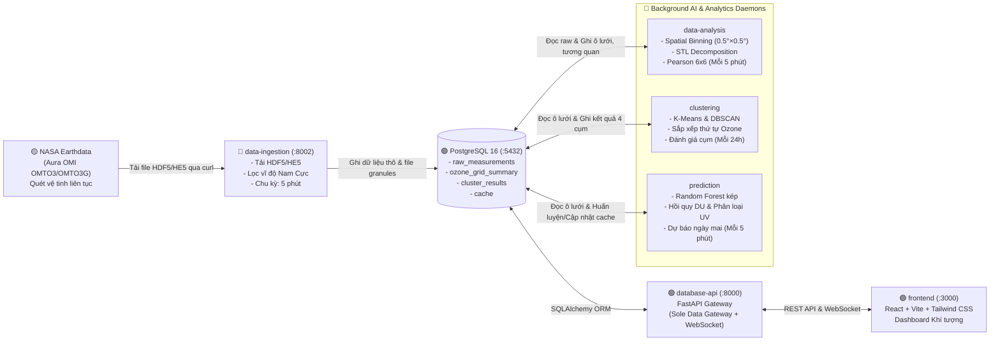

# 🌍 OzoneCast — Hệ Thống Giám Sát & Dự Báo Tầng Ozone Vệ Tinh NASA

Hệ thống kiến trúc **Microservices phân tán** thu thập dữ liệu vệ tinh NASA Aura OMI (định dạng HDF5/HE5), lưu trữ và xử lý thời gian thực trên PostgreSQL, tự động phân tích chuỗi thời gian, phân cụm không gian và dự báo nồng độ Ozone kèm cảnh báo bức xạ cực tím (UV) trọng tâm tại **Bán đảo Nam Cực**.

---

## 🏗️ 1. Sơ Đồ Kiến Trúc Hệ Thống (Microservices Architecture)

Hệ thống bao gồm **7 dịch vụ độc lập**, giao tiếp qua mạng nội bộ Docker và Cổng API trung tâm:



### Chi tiết các Service và Cổng dịch vụ:

| Tên Service | Container Name | Cổng Host | Vai trò & Nhiệm vụ chính |
| :--- | :--- | :---: | :--- |
| **`frontend`** | `ozone-frontend` | **`3000`** | Giao diện Web Dashboard: Bản đồ nhiệt Ozone Map, Biểu đồ quan trắc & dự báo 7 ngày, Phân cụm K-Means, Phân rã chuỗi thời gian. |
| **`database-api`** | `ozone-database-api` | **`8000`** | Cổng giao tiếp REST API trung tâm (FastAPI + Swagger UI + WebSocket streaming). |
| **`postgres`** | `ozone-postgres` | **`5432`** | Cơ sở dữ liệu quan hệ PostgreSQL 16 lưu trữ toàn bộ dữ liệu quan trắc và cache phân tích. |
| **`data-ingestion`** | `ozone-data-ingestion` | **`8002`** | Scheduler tự động quét NASA CMR API, tải file HDF5/HE5, giải nén và lọc lát cắt tọa độ Nam Cực (5 phút/lần). |
| **`data-analysis`** | `ozone-data-analysis` | *(Nội bộ)* | Background Daemon: Gom ô lưới không gian (0.5°×0.5°), phân tích tương quan 6 biến khí quyển, phân tách Trend/Seasonal (5 phút/lần). |
| **`prediction`** | `ozone-prediction` | *(Nội bộ)* | Background Daemon: Huấn luyện và chạy mô hình Học máy Random Forest kép (Hồi quy nồng độ DU + Phân loại rủi ro UV theo chuẩn WMO) (5 phút/lần). |
| **`clustering`** | `ozone-clustering` | *(Nội bộ)* | Background Daemon: Khai phá dữ liệu đa biến K-Means / DBSCAN, tự động sắp xếp thứ tự nhãn cụm theo nồng độ Ozone tăng dần (24h/lần). |

---

## 🛰️ 2. Phạm Vi Không Gian & Đặc Trưng Dữ Liệu Vệ Tinh

Dự án tập trung nghiên cứu chuyên sâu về **Lỗ thủng tầng Ozone Nam Cực (Antarctic Ozone Hole)**:

* **Tọa độ khu vực nghiên cứu (Bán đảo Nam Cực):**
  * **Vĩ độ (Latitude):** $-70.0^\circ\text{S}$ đến $-63.0^\circ\text{S}$
  * **Kinh độ (Longitude):** $-75.0^\circ\text{W}$ đến $-55.0^\circ\text{W}$
* **Sản phẩm dữ liệu NASA:**
  * **OMTO3 (Level-2 Swath):** Dữ liệu vệt quét vệ tinh theo từng quỹ đạo bay thực tế.
  * **OMTO3G (Level-2G Gridded):** Dữ liệu lưới toàn cầu gộp trong ngày.
* **10 trường vật lý khí quyển được trích xuất từ file HDF5 (`h5py`):**
  1. `ColumnAmountO3`: Nồng độ tầng Ozone cột khí quyển (Dobson Units - DU).
  2. `Latitude`: Vĩ độ trắc địa.
  3. `Longitude`: Kinh độ trắc địa.
  4. `SecondsInDay` / `Time`: Mốc thời gian quan sát thực tế trong ngày.
  5. `QualityFlags`: Cờ chất lượng thuật toán OMI.
  6. `GroundPixelQualityFlags`: Chất lượng pixel mặt đất (băng tuyết, mây che phủ).
  7. `SolarZenithAngle` (SZA): Góc thiên đỉnh mặt trời (lọc loại bỏ dữ liệu nhiễu vùng cực $> 84^\circ$).
  8. `RadiativeCloudFraction`: Tỷ lệ che phủ của mây quang học.
  9. `CloudPressure`: Áp suất đỉnh mây (hPa).
  10. `Reflectivity331` / `UV Aerosol`: Độ phản xạ bề mặt băng tuyết và chỉ số sol khí.

---

## ⚡ 3. Các Tính Năng Nổi Bật Trên Dashboard

1. **Bản đồ Quan trắc Không gian (Ozone Map):**
   * Hiển thị lưới trắc địa nhiệt với ngưỡng thủng Ozone $220\text{ DU}$.
   * Tích hợp theo dõi tọa độ con trỏ chuột thời gian thực (hiển thị tọa độ Vĩ độ/Kinh độ chính xác khi rê chuột trên bản đồ).
2. **Dự báo Học máy (Machine Learning Prediction):**
   * Dự báo nồng độ Ozone trung bình toàn vùng Bán đảo Nam Cực vào ngày mai bằng mô hình **Random Forest Regressor** ($R^2 \approx 0.967, \text{MAE} \approx \pm 4.69\text{ DU}$).
   * Đánh giá nguy cơ bức xạ UV theo chuẩn an toàn quốc tế WMO / WHO bằng **Random Forest Classifier**.
   * Chức năng **Dự báo điểm theo ngày tùy chọn**: Cho phép chọn ngày tương lai bất kỳ (tích hợp chu kỳ mùa vụ khí quyển và cơ chế suy giảm độ tin cậy theo thời gian dự báo).
   * **Biểu đồ chuỗi thời gian 7 ngày:** Hiển thị trực quan 7 ngày quan sát gần nhất nối tiếp điểm dự báo ngày mai, tự động tích hợp thanh cuộn ngang mượt mà khi dữ liệu vượt quá 7 ngày.
3. **Phân cụm Không gian Đa biến (Spatial Clustering):**
   * Phân chia 4 cụm khí quyển đặc trưng dựa trên: Vĩ độ, Kinh độ, Nồng độ Ozone và Độ phản xạ bề mặt.
   * Tự động sắp xếp (re-index) nhãn cụm theo nồng độ Ozone tăng dần (Cụm 1: Nguy cơ suy giảm cao nhất $\rightarrow$ Cụm 4: Vùng Ozone dày an toàn).
4. **Phân tích Chuỗi thời gian & Tương quan Khí quyển:**
   * Tách thành phần xu hướng (Trend) và chu kỳ mùa vụ (Seasonal).
   * Ma trận tương quan Pearson 6 biến khí quyển thời gian thực tính toán trực tiếp từ cơ sở dữ liệu.

---

## 🚀 4. Hướng Dẫn Cài Đặt & Khởi Chạy

### Yêu cầu hệ thống:
* **Docker** & **Docker Compose** (phiên bản v2.20 trở lên).
* RAM tối thiểu: 4GB (Khuyến nghị 8GB).
* Dung lượng ổ đĩa trống: ~5GB.

---

### Bước 1: Sao chép mã nguồn và cấu hình môi trường
```bash
git clone https://github.com/your-username/OzoneCast.git
cd OzoneCast

# Tạo file biến môi trường từ mẫu có sẵn
cp .env.example .env
```
*(Nếu muốn cào trực tiếp từ server NASA, điền thông tin tài khoản Earthdata vào `NASA_USERNAME` và `NASA_PASSWORD` trong file `.env`).*

---

### Bước 2: Khởi chạy toàn bộ hệ thống bằng Docker Compose

Chỉ cần một câu lệnh duy nhất:
```bash
docker compose up -d --build
```

Hệ thống sẽ tự động tải image, build các microservices, khởi tạo bảng cơ sở dữ liệu PostgreSQL và kích hoạt các daemon chạy ngầm.

---

### Bước 3: Truy cập hệ thống

* **Giao diện Web Dashboard:** [http://localhost:3000](http://localhost:3000)
* **Tài liệu Swagger REST API:** [http://localhost:8000/docs](http://localhost:8000/docs)
* **API Quản lý nạp dữ liệu vệ tinh:** [http://localhost:8002/docs](http://localhost:8002/docs)
* **Kết nối PostgreSQL (DBeaver / pgAdmin):** `localhost:5432` | User: `postgres` | Password: `postgres` | DB: `ozone_db`

---

### Bước 4: Kiểm tra trạng thái và Logs dịch vụ

* **Xem danh sách các containers đang chạy:**
  ```bash
  docker compose ps
  ```
* **Xem tiến trình nạp dữ liệu vệ tinh NASA:**
  ```bash
  docker logs -f ozone-data-ingestion --tail 50
  ```
* **Xem tiến trình dự báo máy học:**
  ```bash
  docker logs -f ozone-prediction --tail 50
  ```
* **Dừng toàn bộ hệ thống:**
  ```bash
  docker compose down
  ```

---

## 🛠️ 5. Cấu Trúc Thư Mục Dự Án

```text
OzoneCast/
├── docker-compose.yml              # Cấu hình triển khai 7 microservices Docker
├── .env.example                    # Cấu hình biến môi trường mẫu
├── db/
│   └── init/
│       └── 01_init.sql             # Script khởi tạo cấu trúc bảng, khóa chính & chỉ mục
├── frontend/                       # Microservice 1: Giao diện React + Vite + Tailwind
│   ├── src/
│   │   ├── components/             # OzoneMap, PredictionPanel, ClusteringPanel...
│   │   ├── api/                    # Axios API Client kết nối Gateway 8000
│   │   └── config/                 # Tọa độ giới hạn Bán đảo Nam Cực, bảng màu Ozone
│   └── Dockerfile
├── services/
│   ├── database-api/               # Microservice 2: FastAPI Gateway (Cổng dữ liệu duy nhất)
│   │   ├── app/routers/            # Endpoints: raw data, grid summary, clusters, predictions
│   │   └── Dockerfile
│   ├── data-ingestion/             # Microservice 3: Worker nạp file HDF5/HE5 NASA
│   │   ├── app/                    # Module đọc H5py, cào CMR API, kiểm tra tọa độ
│   │   ├── seed/urls_seed.txt      # Danh sách URL vệ tinh định tuyến sẵn
│   │   └── Dockerfile
│   ├── data-analysis/              # Microservice 4: Background daemon phân tích dữ liệu
│   │   └── Dockerfile
│   ├── prediction/                 # Microservice 5: Background daemon Học máy Random Forest
│   │   ├── app/                    # Regressor, Classifier, Advisory Engine, Trainer
│   │   └── Dockerfile
│   └── clustering/                 # Microservice 6: Background daemon phân cụm K-Means/DBSCAN
│       ├── app/                    # Tiền xử lý ma trận, thuật toán cụm, profiler nhãn
│       └── Dockerfile
└── README.md                       # Tài liệu hướng dẫn dự án
```

---

## 📜 6. Giấy Phép & Nguồn Dữ Liệu
* Dữ liệu quan trắc tầng Ozone được cung cấp bởi **NASA Earth Science Data and Information System (ESDIS)** / **Aura Ozone Monitoring Instrument (OMI)**.
* Dự án phục vụ mục đích nghiên cứu học thuật và phi thương mại.
