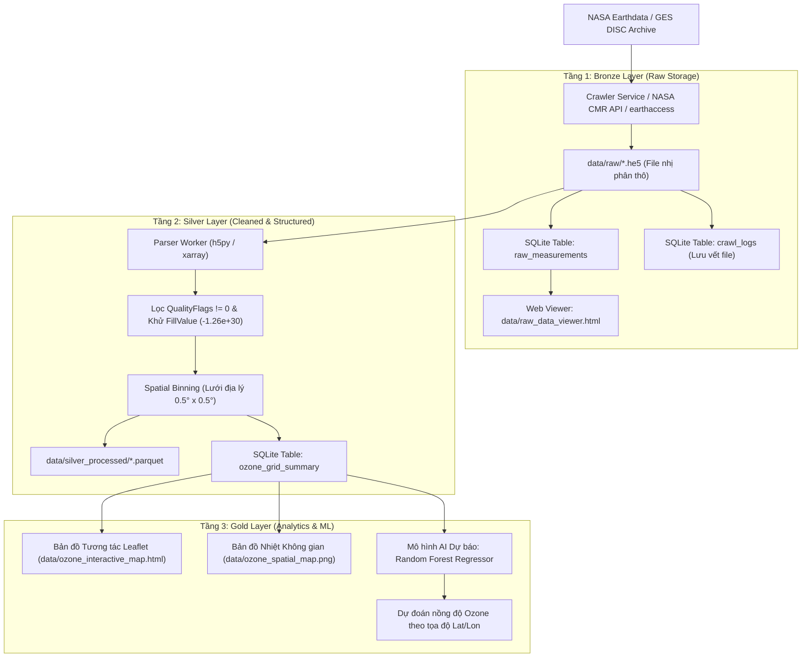

# 🛰️ NASA Ozone Automated Data Pipeline & Analytics (ETL & ML)

[](https://www.python.org/)
[](https://urs.earthdata.nasa.gov/)
[-emerald.svg)](#2-kiến-trúc-hệ-thống-medallion-pipeline)
[](#)

Hệ thống tự động hóa thu thập, xử lý và trực quan hóa dữ liệu vệ tinh khí quyển đo nồng độ Ozone (Tổng cột Ozone - Total Column Ozone) từ các cảm biến **Aura/OMI** và **Suomi-NPP/OMPS** của Cơ quan Hàng không và Vũ trụ Hoa Kỳ (**NASA**).

Hệ thống được thiết kế theo chuẩn **Medallion Architecture (Bronze - Silver - Gold)** phục vụ từ việc lưu trữ thô, làm sạch, trực quan hóa trên bản đồ tương tác đến huấn luyện mô hình Machine Learning dự báo.

---

## 📑 Mục Lục
- [1. Giới thiệu Dữ liệu Vệ tinh NASA](#1-giới-thiệu-dữ-liệu-vệ-tinh-nasa)
- [2. Kiến trúc Hệ thống (Medallion Pipeline)](#2-kiến-trúc-hệ-thống-medallion-pipeline)
- [3. Cấu trúc Thư mục Dự án](#3-cấu-trúc-thư-mục-dự-án)
- [4. Hướng dẫn Cài đặt & Cấu hình](#4-hướng-dẫn-cài-đặt--cấu-hình)
- [5. Sổ tay Lệnh CLI (Command Reference)](#5-sổ-tay-lệnh-cli-command-reference)
- [6. Mô tả các Trường Dữ liệu Đo đạc](#6-mô-tả-các-trường-dữ-liệu-đo-đạc)
- [7. Bản đồ & Giao diện Trực quan](#7-bản-đồ--giao-diện-trực-quan)

---

## 1. Giới thiệu Dữ liệu Vệ tinh NASA

Vệ tinh **Aura (cảm biến OMI)** và **Suomi-NPP (cảm biến OMPS)** quay quanh quỹ đạo cực của Trái Đất khoảng 14 – 15 vòng/ngày (~90–100 phút/vòng bay). 

- **Sản phẩm chính:** `OMTO3` (Level-2 Total Column Ozone) và `NMTO3-L2`.
- **Đơn vị đo:** Dobson Units (**DU**) – $1\text{ DU} = 2.69 \times 10^{16}\text{ phân tử } O_3/\text{cm}^2$.
- **Định dạng file:** HDF-EOS5 (`.he5`) và NetCDF4 (`.nc`), dung lượng 20MB – 40MB mỗi file quét quỹ đạo (granule).
- **Cơ chế xác thực:** NASA Earthdata Login (SSO Authentication).

---

## 2. Kiến trúc Hệ thống (Medallion Pipeline)



---

## 3. Cấu trúc Thư mục Dự án

```text
d:\UTE\HK7\Ozone\
├── config/
│   └── settings.py              # Quản lý cấu hình Pydantic, đường dẫn và biến môi trường
├── src/
│   ├── db/
│   │   └── models.py            # Khởi tạo SQLAlchemy schema (crawl_logs, ozone_grid_summary)
│   ├── crawler/
│   │   ├── nasa_client.py       # Xác thực Earthdata SSO (_netrc, cookie jar, curl, requests)
│   │   ├── crawler_service.py   # Tự động hóa truy vấn NASA CMR API & đồng bộ tăng tiến
│   │   └── earthaccess_crawler.py # Module tích hợp thư viện chuẩn earthaccess của NASA
│   ├── etl/
│   │   ├── inspector.py         # Công cụ soi cấu trúc dataset HDF5, NetCDF & thuộc tính
│   │   └── parser_l2.py         # Bộ lọc Quality Flags, xử lý Swaths và Spatial Binning
│   ├── analytics/
│   │   ├── raw_viewer.py        # Xuất bảng dữ liệu thô ra SQLite & Web Viewer tương tác
│   │   └── visualizer.py        # Vẽ bản đồ nhiệt Matplotlib & bản đồ tương tác Leaflet
│   ├── ml/
│   │   └── predictor.py         # Huấn luyện mô hình Random Forest chuỗi thời gian & vị trí
│   ├── pipeline/
│   │   └── scheduler.py         # Bộ lập lịch định kỳ (APScheduler) chạy tự động 1h - 2h/lần
│   └── utils/
│       └── mock_granule.py      # Sinh dữ liệu mẫu chuẩn HDF-EOS5 để test offline
├── data/
│   ├── raw/                     # Chứa file vệ tinh thô (.he5 / .nc)
│   └── silver_processed/        # Chứa file sạch nén Parquet
├── main.py                      # CLI trung tâm điều khiển toàn bộ dự án
├── requirements.txt             # Danh sách thư viện phụ thuộc
├── .env.example                 # Mẫu file cấu hình tài khoản
└── README.md                    # Tài liệu hướng dẫn sử dụng
```

---

## 4. Hướng dẫn Cài đặt & Cấu hình

### Bước 1: Chuẩn bị môi trường Python
Yêu cầu **Python 3.10 trở lên** (khuyến nghị 3.11 hoặc 3.12).
```bash
# Clone dự án và truy cập vào thư mục
cd Ozone

# Tạo và kích hoạt môi trường ảo (khuyến nghị)
python -m venv venv
# Trên Windows:
.\venv\Scripts\activate
# Trên Linux/macOS:
source venv/bin/activate

# Cài đặt toàn bộ thư viện cần thiết
pip install -r requirements.txt
```

### Bước 2: Cấu hình tài khoản NASA Earthdata
1. Đăng ký tài khoản miễn phí tại [NASA Earthdata Login](https://urs.earthdata.nasa.gov/).
2. Sao chép file cấu hình mẫu `.env.example` thành `.env`:
   ```bash
   copy .env.example .env
   ```
3. Cập nhật thông tin đăng nhập trong file `.env`:
   ```ini
   NASA_USERNAME=your_username
   NASA_PASSWORD=your_password
   ```

---

## 5. Sổ tay Lệnh CLI (Command Reference)

Toàn bộ thao tác của hệ thống được thực thi qua tệp lệnh [main.py](file:///d:/UTE/HK7/Ozone/main.py):

| Mục tiêu thao tác | Lệnh thực thi | Mô tả chi tiết |
| :--- | :--- | :--- |
| **Khởi tạo Database** | `py main.py init-db` | Tạo các bảng SQLite cần thiết trong `data/ozone_pipeline.db`. |
| **Tải file thật tự động** *(Khuyên dùng)* | `py main.py fetch-real` | Tự động gọi **NASA CMR API** tìm file `OMTO3` thật mới nhất và tải về `data/raw/` (không cần cài thêm thư viện nặng). |
| **Tải qua `earthaccess`** | `py main.py fetch-auto` | Quét theo danh mục nhiều sản phẩm (`OMTO3`, `NMTO3-L2`, v.v.) qua thư viện chính thức của NASA. |
| **Xem dữ liệu thô trực quan** | `py main.py view-raw "data/raw/<tên_file>.he5"` | Lưu toàn bộ các dòng đo thô vào SQLite và sinh trang web [data/raw_data_viewer.html](file:///d:/UTE/HK7/Ozone/data/raw_data_viewer.html) để xem bảng số liệu và bản đồ. |
| **Soi cấu trúc biến (Inspect)** | `py main.py inspect-file "data/raw/<tên_file>.he5"` | Dùng `h5py` duyệt toàn bộ cây HDF5, xem kích thước ma trận (shape), kiểu dữ liệu (dtype) và các attributes. |
| **Nạp file script NASA** | `py main.py import-script "<path_to_script>.sh"` | Đọc file script tải từ nút **Get cUrl script** trên web NASA và đưa danh sách URL vào hàng đợi. |
| **Đồng bộ tải tăng tiến** | `py main.py sync` | Tải tất cả các file mới đang ở trạng thái `PENDING` về thư mục `data/raw/`. |
| **Làm sạch ETL (Silver)** | `py main.py parse` | Lọc nhiễu, loại bỏ mây che, tính trung bình theo lưới tọa độ `0.5°` và xuất ra file `Parquet`. |
| **Vẽ bản đồ nồng độ Ozone** | `py main.py plot-map` | Xuất bản đồ nhiệt PNG (`data/ozone_spatial_map.png`) và bản đồ Web tương tác (`data/ozone_interactive_map.html`). |
| **Huấn luyện mô hình ML** | `py main.py train-model` | Huấn luyện mô hình Random Forest Regressor dự báo nồng độ Ozone dựa trên đặc trưng chuỗi thời gian & vị trí. |
| **Dự báo nồng độ Ozone** | `py main.py predict --lat 10.8 --lon 106.6` | Dự đoán nồng độ Ozone (DU) tại tọa độ mong muốn (ví dụ TP.HCM: Vĩ độ 10.8, Kinh độ 106.6). |
| **Chạy lịch tự động ngầm** | `py main.py scheduler` | Chạy bộ lập lịch daemon tự động cào và xử lý dữ liệu định kỳ mỗi 2 giờ/lần. |
| **Xem trạng thái hệ thống** | `py main.py status` | Hiển thị tổng số granule thô, số điểm đo sạch và chỉ số lỗi. |

---

## 6. Mô tả các Trường Dữ liệu Đo đạc

Trong mỗi tệp đo đạc thô của NASA (như `OMTO3`), hệ thống trích xuất 4 nhóm trường dữ liệu cốt lõi:

| Trường Dữ liệu | Đường dẫn HDF-EOS5 Swath | Ý nghĩa & Đơn vị |
| :--- | :--- | :--- |
| **`Latitude`** | `.../Geolocation Fields/Latitude` | Vĩ độ địa lý các điểm quét vệ tinh ($-90^\circ$ đến $+90^\circ$). |
| **`Longitude`** | `.../Geolocation Fields/Longitude` | Kinh độ địa lý các điểm quét vệ tinh ($-180^\circ$ đến $+180^\circ$). |
| **`Time`** | `.../Geolocation Fields/Time` | Mốc thời gian quét UTC (số giây tính từ 01/01/1993). |
| **`ColumnAmountO3`** | `.../Data Fields/ColumnAmountO3` | Tổng nồng độ cột khí quyển Ozone (**Dobson Units - DU**). Giá trị thực tế dao động từ 150 – 500 DU. Giá trị lỗi (`_FillValue`) là $-1.26765 \times 10^{30}$. |
| **`QualityFlags`** | `.../Data Fields/QualityFlags` | Cờ chất lượng phép đo: `0` là điểm đo chuẩn cao, các giá trị khác thể hiện mây che hoặc nhiễu bức xạ. |

---

## 7. Bản đồ & Giao diện Trực quan

Hệ thống cung cấp sẵn 2 giao diện trực quan hóa độc lập:

1. **Trang xem Dữ liệu Thô ([data/raw_data_viewer.html](file:///d:/UTE/HK7/Ozone/data/raw_data_viewer.html)):**
   - Tích hợp **DataTables.js**: Phân trang, lọc, tìm kiếm từng điểm đo thô theo vĩ độ/kinh độ.
   - Tích hợp **Leaflet.js**: Hiển thị đường bay quét thực tế của vệ tinh (Swath Orbit Track).
2. **Bản đồ Phân bố Toàn cầu ([data/ozone_interactive_map.html](file:///d:/UTE/HK7/Ozone/data/ozone_interactive_map.html)):**
   - Mã màu Heatmap theo thang nồng độ Dobson Units (DU).
   - Popup hiển thị thông số chi tiết khi nhấp chuột vào từng ô lưới địa lý.

---

## 🛡️ Lưu ý khi Push lên Git

Dự án đã được cấu hình sẵn file [`.gitignore`](file:///d:/UTE/HK7/Ozone/.gitignore) để:
- **Không push thông tin đăng nhập:** File `.env` chứa mật khẩu NASA được tự động bỏ qua.
- **Không push file dữ liệu lớn:** Thư mục `data/raw/*`, `data/silver_processed/*` và file database `*.db` được bỏ qua, chỉ giữ lại cấu trúc thư mục rỗng qua `.gitkeep`.
- **Không push cache:** Các thư mục `__pycache__/` và môi trường ảo `venv/` được tự động loại trừ.
